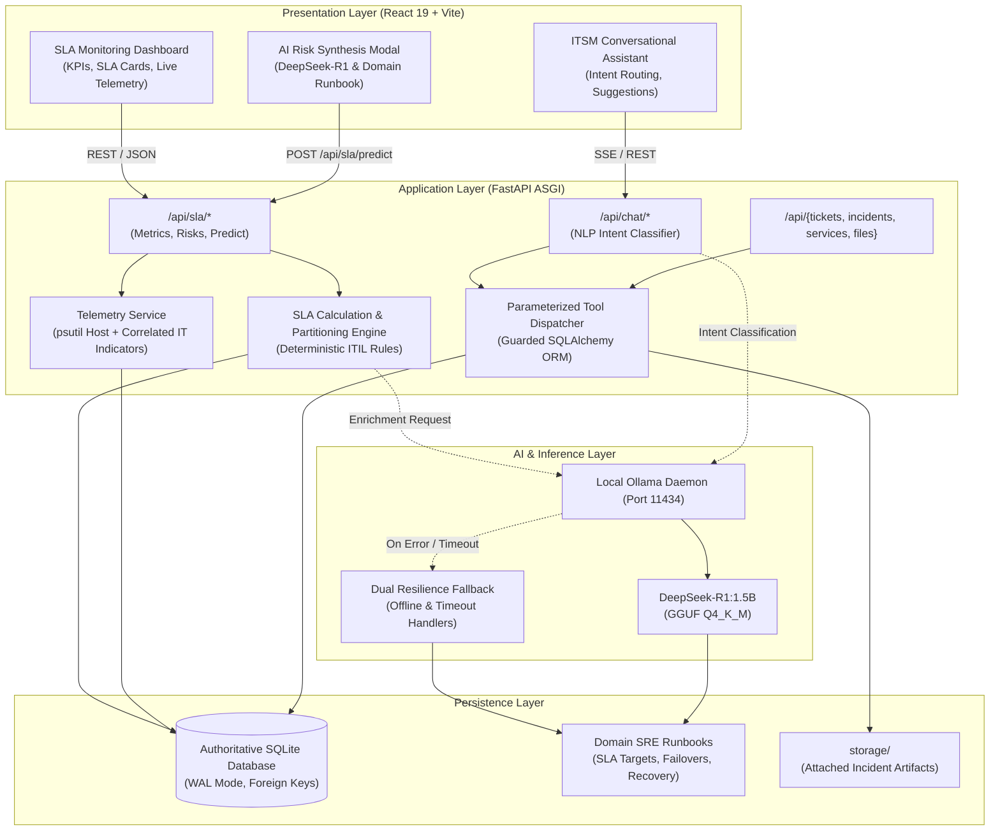

# Intelligent Service Level Management (ISLM) Using a Small Language Model

[](https://www.python.org/)
[](https://fastapi.tiangolo.com/)
[](https://react.dev/)
[](https://www.sqlite.org/)
[](https://ollama.com/)
[](https://ollama.com/library/deepseek-r1:1.5b)
[](https://opensource.org/licenses/MIT)

> **Intelligent Service Level Management (ISLM)** is an enterprise IT Service Management (ITSM) and Service Level Agreement (SLA) operations platform powered by an on-premises, privacy-preserving **Small Language Model (DeepSeek-R1 1.5B)**. It unifies deterministic rule-based SLA tracking, host and simulated IT telemetry, ITIL-grounded domain runbooks, and natural-language assistance into a single unified system.

---

## 1. Project Overview

Modern IT organizations struggle with ticket prioritization, SLA breach prevention, and rapid incident response. Commercial LLMs introduce data-privacy risks, high operational costs, and unpredictability (hallucinations). 

**ISLM** solves this by pairing a lightweight, locally deployed Small Language Model (SLM) with a deterministic, authoritative relational backend. DeepSeek-R1 1.5B has two distinct operational responsibilities:
1. **Natural-Language Intent Interpretation (ITSM Chatbot):** Translates freeform user prompts into structured JSON intents (`operation`, `entity`, `filters`, `record_id`). FastAPI validates those intents and executes parameterized SQLAlchemy ORM operations.
2. **Qualitative SLA Risk Synthesis (AI Modal):** Receives authoritative pre-calculated numerical metrics from SQLite, live host telemetry, and domain runbook procedures to generate qualitative root-cause explanations and structured troubleshooting plans.

The SLM does not directly execute SQL, independently modify database records, or autonomously perform ITSM operations. Numerical calculations (elapsed time, remaining deadlines, SLA percentages, breach classifications) are strictly computed by Python and SQLite, while the SLM provides contextual reasoning, intent parsing, and domain runbook-grounded troubleshooting plans.

---

## 2. Problem Statement

1. **Unpredictable LLM Reasoning on Hard Numbers:** Generative language models frequently hallucinate timestamps, mathematical percentages, and operational metrics.
2. **Data Privacy & Compliance in ITSM:** Sending enterprise operational data, server hostnames, network topologies, and employee logs to third-party cloud APIs poses significant security and regulatory risks.
3. **Siloed Telemetry & SLA Tracking:** Monitoring telemetry (CPU, memory, packet loss) is often disconnected from ticketing workflows, delaying MTTR (Mean Time to Resolution).
4. **Hardware Constraints:** Small and medium enterprises require intelligent IT automation that runs on standard commodity workstations without expensive multi-GPU clusters.

---

## 3. Project Objectives

- **100% Structured SLA Field Consistency with SQLite Values:** Ensure all structured numerical and status fields (elapsed time, remaining deadlines, SLA percentages, and breach classifications) in the AI Risk Synthesis match authoritative SQLite-derived values with 100% consistency, eliminating mathematical hallucinations (this refers specifically to structured numerical and status field consistency with SQLite facts, not overall unconstrained SLM semantic accuracy).
- **Privacy-Preserving On-Premises SLM:** Run DeepSeek-R1 1.5B entirely on local CPU/RAM via Ollama without cloud telemetry or data leakage.
- **Domain Runbook-Grounded Troubleshooting:** Ground AI recommendations directly in verified SRE procedures and operational runbooks rather than speculative generative answers.
- **Fail-Safe Operational Resilience:** Implement sub-3-second fallback mechanisms that guarantee uninterrupted dashboard functionality and technical action plans even if the local SLM daemon is offline or times out.
- **Dual-Interface Management:** Provide both a visual real-time SLA Monitoring Dashboard and an interactive conversational assistant with safe parameterized execution.

---

## 4. System Architecture



### Security & Intent Dispatching

```
User Query → Intent Classifier / Dispatcher → Service Layer → Parameterized SQLAlchemy ORM → SQLite DB
```

* **Safe Execution:** DeepSeek-R1 1.5B interprets natural-language requests and generates structured intents (`operation`, `entity`, `filters`, `record_id`). The SLM does **not** directly execute SQL, independently modify database records, or autonomously perform ITSM operations.
* **Backend Validation:** FastAPI receives and validates all intents against strict Pydantic schemas, executing only safe, parameterized SQLAlchemy ORM queries against the SQLite database.
* **Destructive Safety Protocol:** Destructive operations (such as ticket deletion, service removal, or file deletion) require explicit user confirmation and backend validation before execution.

---

## 5. Technology Stack

| Layer | Technology | Version | Description |
| :--- | :--- | :--- | :--- |
| **Frontend** | React + Vite | React 19.2 / Vite 8.2 | Responsive layout, glassmorphism UI, tabbed dashboard navigation |
| **Backend** | Python & FastAPI | Python 3.10+ / FastAPI 0.115 | Asynchronous REST API, CORS-enabled, strict Pydantic schemas |
| **Database** | SQLite 3 + SQLAlchemy | SQLAlchemy 2.0 | Relational schema with 6 tables (`users`, `services`, `tickets`, `sla`, `incidents`, `files`) |
| **Local SLM** | DeepSeek-R1:1.5B via Ollama | Q4_K_M GGUF | Local qualitative root-cause synthesis, incident runbook matching, intent classification |
| **Telemetry** | `psutil` + Sockets + DB Probes | psutil 6.1+ | Real host telemetry (CPU, RAM, loopback, SQLite latency) paired with labeled simulated indicators |

---

## 6. Main Modules and Features

### 6.1 Real-Time SLA Monitoring Dashboard
* **Mutually Exclusive SLA Partitioning:** Active items are strictly partitioned into mutually exclusive subsets:
  $$\text{Total Monitored} = \text{Breached} + \text{At Risk} + \text{Healthy}$$
  $$\text{Compliance Rate} = \frac{\text{Total Monitored} - \text{Breached}}{\text{Total Monitored}} \times 100$$
* **Synchronized Evaluation Clocks:** Dashboard cards and AI modals share the exact evaluation reference timestamp to eliminate clock drift.
* **Incident & Ticket Monitoring:** Tracks both reactive end-user support tickets and infrastructure incidents.

### 6.2 Host & IT Infrastructure Telemetry
* **Real Host Telemetry (Live):** Localhost TCP socket latency, SQLite query response latency (`SELECT 1`), host CPU utilization percentage (`psutil`), and virtual memory consumption.
* **Correlated Simulated IT Telemetry:** Clearly labeled simulated indicators (`[Simulated]`) representing network WAN latency, packet loss, Cisco router status, switch CRC errors, Redis cache disk capacity, database replication lag, and backup verification — dynamically correlated with active SQLite incident and ticket records.

### 6.3 Domain Runbook-Grounded SLM
* **Factual Grounding:** Numerical SLA calculations are injected from SQLite into the SLM prompt, preventing numerical hallucinations.
* **Structured 6-Part AI Synthesis:**
  1. Authoritative SLA Factsheet (SQLite-derived)
  2. Observed Telemetry Context
  3. SLM Hypothesis (clearly demarcated as unverified)
  4. Specific Troubleshooting Steps (grounded in the verified runbook)
  5. Preventive Recommendations
  6. Confidence Score & Human Verification Notice
* **Resolved Incident Protocol:** When inspecting resolved incidents, the SLM automatically pivots to historical compliance reviews and post-mortem recommendations.

### 6.4 Conversational ITSM Assistant
* **Safe Parameterized Dispatch:** Translates natural-language operational requests into safe ORM operations.
* **Two-Phase Confirmation Protocol:** Destructive operations (`DELETE`, record termination) require explicit user confirmation and backend validation before execution.

---

## 7. How the Small Language Model Works

The Small Language Model (DeepSeek-R1 1.5B) is decoupled into two independent, task-specific pipelines:

### 7.1 Responsibility A: Natural-Language Intent Interpretation (Chat Assistant)
```
User Prompt (e.g. "Show breached SLA items only")
               │
               ▼
   Regex Pre-Filter & Fast-Path Routing
               │
               ▼
   DeepSeek-R1 1.5B via Ollama (JSON Schema Mode)
   (Outputs: operation, entity, filters, record_id)
               │
               ▼
   FastAPI Intent Validation (Pydantic Schemas)
               │
               ▼
   Parameterized SQLAlchemy ORM Dispatcher
   (Safe, read-only or confirmed execution)
               │
               ▼
   Structured JSON Response Rendered as UI Table / Chat Bubble
```
* The SLM never generates raw SQL.
* It outputs strictly structured intent parameters that are validated by FastAPI before execution.
* Destructive actions (`DELETE`, file deletion) trigger a mandatory two-phase confirmation step.

### 7.2 Responsibility B: Qualitative SLA Risk Synthesis (AI Modal)
```
User Action: Click "AI Risk Synthesis" on Dashboard Card
               │
               ▼
   Authoritative SQLite Fact Evaluation
   (Elapsed time, remaining time, SLA % calculated in Python)
               │
               ▼
   Live Host & Correlated Telemetry Assembly
   (psutil metrics + labeled simulated network indicators)
               │
               ▼
   Domain SRE Runbook Retrieval
   (Matching affected service/component to verified runbook)
               │
               ▼
   Strict System Prompt Construction (Facts + Rules)
               │
               ▼
   Local Inference via Ollama (DeepSeek-R1:1.5B)
   ┌───────────────────────┬───────────────────────┐
   │ Success (< 120s)      │ Daemon Offline / Timeout
   ▼                       ▼
Structured 6-Part       Dual Fallback Engine
Qualitative Synthesis   (Deterministic Runbook Injected)
               │                       │
               └───────────┬───────────┘
                           ▼
             Rendered in Dashboard Modal
```
* **Structured Field Anchoring:** Numerical facts (timestamps, remaining minutes, breach percentage) are hard-bound to authoritative SQLite data.
* **Resolved Incident Protocol:** When inspecting resolved incidents, the model automatically pivots to post-resolution reviews rather than raising active breach alarms.

---

## 8. DeepSeek-R1 1.5B and Ollama

### Why DeepSeek-R1 1.5B?
DeepSeek-R1:1.5B is a compact, reasoning-optimized Small Language Model based on the Qwen2 architecture. With 1.8 billion parameters quantized to 4-bit (`Q4_K_M`), it requires only **~1.1 GB of RAM/VRAM**, allowing it to execute entirely on standard multi-core desktop CPUs without dedicated graphics hardware.

### Benchmark & Evaluation Highlights
Based on our experimental evaluation across 12 live operational test cases:
* **Mean Inference Latency:** 55.501s across 12 operational test cases on a 4-core/8-thread CPU (Min: 40.373s, Max: 77.208s, Median: 59.466s).
* **Structured SLA Field Consistency:** 100.0% numerical and status alignment between structured modal fields and SQLite facts (eliminating mathematical hallucinations). This metric measures structured numerical consistency with backend facts, not open-ended semantic text accuracy.
* **Response Completeness:** 100.0% generation of all 6 required structured technical sections across all test runs.
* **Fallback Resilience Latency:** 2.164s recovery on connection refusal (when Ollama daemon is offline). In our experimental fault-injection harness, timeout fallback completed in 1.817s under a deliberately shortened 1.5s client test timeout (configured to rapidly verify graceful degradation; standard production client timeout is 120.0s).

---

## 9. Database Description

The system persists data in SQLite with Write-Ahead Logging (`WAL`) mode and foreign key enforcement enabled:

| Table | Primary Columns | Purpose |
| :--- | :--- | :--- |
| `users` | `id`, `name`, `email`, `role`, `created_at` | ITSM staff, technicians, and system administrators |
| `services` | `id`, `service_name`, `description`, `status`, `owner` | Core infrastructure services (Database, Network, API Gateway, etc.) |
| `tickets` | `id`, `title`, `description`, `category`, `priority`, `status`, `assigned_to`, `service_id` | End-user service and support requests |
| `incidents` | `id`, `incident_id`, `title`, `severity`, `status`, `affected_service`, `affected_component` | Production outages, infrastructure alerts, monitoring triggers |
| `sla` | `id`, `service_id`, `priority`, `response_time`, `resolution_time` | Service level commitments and resolution targets |
| `files` | `id`, `file_name`, `file_path`, `file_size`, `uploaded_by` | Operational runbooks, diagnostic logs, and post-mortems |

### Database Configuration & Integrity
* **Configurable Connection:** The database connection is configurable through the `DATABASE_URL` environment variable in `.env` (e.g. `DATABASE_URL=sqlite:///./islm_recovered.db` or `DATABASE_URL=sqlite:///./islm.db`), resolved dynamically by `backend/config.py`.
* **Zero Machine Drift:** Uses relative or environment-provided URLs so the repository can be cloned on any computer without hardcoded paths.
* **Integrity Checked:** Passes SQLite `PRAGMA integrity_check;` with result `ok`.
* **Idempotent Seeding Behavior:** Database seeding (`python -m backend.database.seed`) populates sample incidents, users, services, tickets, and SLAs only when the corresponding database tables are empty (`Incident.count() == 0`). If existing records are detected, seeding safely skips insertion. To ensure a clean baseline demonstration, it is recommended to use a fresh development database (e.g. configuring `DATABASE_URL=sqlite:///./islm.db` in `.env` or removing prior test databases).

---

## 10. Installation Prerequisites

Ensure the following tools are installed on your Windows computer:

1. **Python 3.10 or newer:** [Download Python](https://www.python.org/downloads/) (Ensure `Add Python to PATH` is checked during installation).
2. **Node.js 18 or newer:** [Download Node.js](https://nodejs.org/) (Includes `npm`).
3. **Ollama:** [Download Ollama for Windows](https://ollama.com/download).

---

## 11. Environment Variable Configuration

Create your local `.env` configuration file from the provided template:

```bash
# In the project root directory
copy .env.example .env
```

The `.env.example` file provides clean default values:

```ini
# Database Connection (uses SQLite relative path)
DATABASE_URL=sqlite:///./islm_recovered.db

# Ollama / SLM Configuration
OLLAMA_URL=http://localhost:11434
OLLAMA_MODEL=deepseek-r1:1.5b

# File Storage Configuration
STORAGE_PATH=./storage
MAX_FILE_SIZE_MB=10
ALLOWED_FILE_TYPES=.pdf,.doc,.docx,.txt,.csv,.xlsx,.png,.jpg,.jpeg,.log,.json,.xml
```

> **Security Note:** `.env` and SQLite database files (`*.db`, `*.db-shm`, `*.db-wal`) are strictly excluded from version control via `.gitignore` to prevent exposing local paths, credentials, or private operational data.

---

## 12. Ollama Model Download & Execution

1. Start the Ollama application from the Windows Start menu or terminal:
   ```bash
   ollama serve
   ```
2. In a separate terminal, pull the required model:
   ```bash
   ollama pull deepseek-r1:1.5b
   ```
3. Verify the model is downloaded and accessible:
   ```bash
   ollama list
   ```

---

## 13. Backend Setup & Execution

1. Open a PowerShell terminal in the project root:
   ```powershell
   # Install backend Python dependencies
   pip install -r backend/requirements.txt
   ```
2. Initialize and seed the SQLite database with baseline ITSM records:
   ```powershell
   python -m backend.database.seed
   ```
   *(Note: The seeder populates sample incidents, users, services, tickets, and SLAs only when the incident table is empty. To demonstrate a clean baseline, it is recommended to run against a fresh development database, e.g. configuring `DATABASE_URL=sqlite:///./islm.db` in `.env` or removing prior test databases).*
3. Start the FastAPI backend server:
   ```powershell
   python -m uvicorn backend.main:app --host 127.0.0.1 --port 8000 --reload
   ```
   - Interactive Swagger API Documentation: [http://127.0.0.1:8000/docs](http://127.0.0.1:8000/docs)
   - Backend Health Check: [http://127.0.0.1:8000/api/health](http://127.0.0.1:8000/api/health)

---

## 14. Frontend Setup & Execution

1. Open a separate PowerShell terminal in the `frontend` directory:
   ```powershell
   cd frontend
   npm install
   ```
2. Start the Vite development server:
   ```powershell
   npm run dev
   ```
3. Open your browser and navigate to **[http://localhost:5173](http://localhost:5173)**.

> **Tip:** You can also run the all-in-one startup script `start.bat` from the project root to automatically check dependencies, seed the database, and launch both backend and frontend servers.

---

## 15. Testing Instructions

### 15.1 Backend Test Suite
Run the automated pytest suite covering database connectivity, health checks, SLA calculation engines, duration parsing, and telemetry:

```powershell
# From project root
python -m pytest
```

Expected output:
```
tests\test_backend.py ......                                             [100%]
============================== 6 passed in 5.45s ==============================
```

### 15.2 Frontend Build & Lint Verification
Verify that the React application compiles cleanly and passes all code quality checks:

```powershell
cd frontend

# Run Oxlint
npm run lint

# Run production build
npm run build
```

---

## 16. API Endpoints

### Chat & Assistant
| Method | Endpoint | Description |
| :--- | :--- | :--- |
| `POST` | `/api/chat` | Natural-language query interface with structured data responses |
| `GET` | `/api/chat/stream` | Server-Sent Events (SSE) chat streaming endpoint |
| `POST` | `/api/chat/confirm` | Execute a previously confirmed destructive operation |

### SLA Monitoring & Intelligence
| Method | Endpoint | Description |
| :--- | :--- | :--- |
| `GET` | `/api/sla/metrics` | Aggregate SLA dashboard KPI metrics and compliance rate |
| `GET` | `/api/sla/risks` | Evaluated SLA risks with optional breach, priority, or service filters |
| `GET` | `/api/sla/telemetry` | Real host telemetry and labeled simulated enterprise metrics |
| `POST` | `/api/sla/predict` | On-demand DeepSeek-R1 1.5B qualitative root cause prediction |
| `GET` | `/api/sla` | List configured SLA priority and response/resolution thresholds |

### Incident Management
| Method | Endpoint | Description |
| :--- | :--- | :--- |
| `GET` | `/api/incidents` | List incidents (filterable by status, severity, service) |
| `GET` | `/api/incidents/{id_or_code}` | Retrieve incident details by numeric ID or code (e.g. `INC-20260902-001`) |
| `POST` | `/api/incidents` | Create a new incident |
| `PUT` | `/api/incidents/{id}` | Update incident status, severity, or assignment |
| `DELETE` | `/api/incidents/{id}` | Delete an incident record |

### Tickets, Services & Files
| Method | Endpoint | Description |
| :--- | :--- | :--- |
| `GET` / `POST` | `/api/tickets` | List tickets / create a new support ticket |
| `PUT` / `DELETE` | `/api/tickets/{id}` | Update ticket details / delete ticket |
| `GET` / `POST` | `/api/services` | List catalog services / register new service |
| `PUT` / `DELETE` | `/api/services/{id}` | Update service / delete service |
| `GET` / `POST` | `/api/files` | List file metadata records / upload a file |
| `DELETE` | `/api/files/{id}` | Delete stored file record and binary asset |
| `GET` | `/api/health` | System health check (Ollama, SQLite, runtime model) |

---

## 17. Project Structure

```
islm-project/
├── frontend/                          # React 19 + Vite Application
│   ├── src/
│   │   ├── components/                # Modular UI Components
│   │   │   ├── ChatMessage.jsx        # Typewriter chat message bubble
│   │   │   ├── ChatInput.jsx          # Input bar with suggestion chips
│   │   │   ├── StatusBar.jsx          # Real-time backend & Ollama health indicators
│   │   │   ├── DataTable.jsx          # Structured table renderer for all entity types
│   │   │   ├── ConfirmDialog.jsx      # Modal dialog for destructive actions
│   │   │   ├── LoadingIndicator.jsx   # Animated loading indicator
│   │   │   └── SlaDashboard.jsx       # SLA Monitoring Dashboard, Telemetry & AI Synthesis
│   │   ├── services/
│   │   │   └── api.js                 # API client wrapper
│   │   ├── App.jsx                    # Root component with tab navigation
│   │   ├── main.jsx                   # React entry point
│   │   └── index.css                  # Viewport flexbox design system & dark theme
│   ├── vite.config.js
│   └── package.json
│
├── backend/                           # FastAPI Application
│   ├── main.py                        # Server initialization and lifespan router setup
│   ├── config.py                      # Dynamic SQLite URL resolution and configuration
│   ├── api/                           # REST API routes
│   │   ├── chat.py                    # Natural language chat & streaming endpoints
│   │   ├── sla.py                     # SLA metrics, risks, and telemetry routes
│   │   ├── incidents.py               # Incident lifecycle management routes
│   │   ├── tickets.py                 # Support ticket CRUD routes
│   │   ├── services.py                # Service catalog routes
│   │   ├── files.py                   # File metadata and upload routes
│   │   └── health.py                  # Health check route
│   ├── database/                      # SQLAlchemy ORM and schema layer
│   │   ├── connection.py              # SQLite session factory
│   │   ├── models.py                  # User, Service, Ticket, SLA, Incident, File models
│   │   ├── schemas.py                 # Pydantic schemas for requests and responses
│   │   ├── seed.py                    # Idempotent database seeder
│   │   ├── reseed.py                  # Reseed utility
│   │   ├── test_llm.py                # Ad-hoc LLM diagnostic script
│   │   └── DATASETS.md                # Comprehensive reference datasets & SQL DDL
│   ├── services/                      # Business Logic Layer
│   │   ├── llm_service.py             # Intent parser, regex extraction & Ollama SLM client
│   │   ├── sla_service.py             # SLA risk calculations, compliance formula & partitioning
│   │   ├── telemetry_service.py       # Live host metrics & simulated IT telemetry
│   │   ├── ticket_service.py          # Ticket business logic and duplicate detection
│   │   ├── incident_service.py        # Incident tracking and query handlers
│   │   ├── service_service.py         # Service catalog operations
│   │   └── file_service.py            # File metadata storage and validation
│   ├── tools/
│   │   └── dispatcher.py              # Validated intent dispatcher
│   ├── prompts/
│   │   └── system_prompt.txt          # DeepSeek-R1 prompt engineering rules and examples
│   └── requirements.txt
│
├── tests/                             # Automated Test Suite
│   └── test_backend.py                # Pytest backend test suite
├── evaluation/                        # Experimental Evaluation Framework
│   ├── README.md                      # Evaluation methodology & replication instructions
│   ├── evaluate_slm.py                # Automated 12-case operational test runner
│   ├── run_experiment.py              # Multi-run latency, CPU, and RAM benchmark harness
│   ├── check_fallback.py              # Connection-refusal & timeout fallback verification
│   ├── update_evaluation_framework.py # Scoring guidelines & rubric updater
│   └── raw_evaluation_results.csv     # Historical benchmark records across 12 test cases
├── storage/                           # Local filesystem storage for uploads
├── pytest.ini                         # Pytest configuration
├── start.bat                          # One-click startup script for Windows
├── .env.example                       # Environment variable template (DATABASE_URL, Ollama config)
├── .gitignore                         # Git exclusion rules
├── LICENSE                            # MIT License
├── ISLM_DEEPSEEK_R1_EXPERIMENTAL_EVALUATION_REPORT.md  # Experimental evaluation report
└── README.md
```

---

## 18. Screenshots & Interface Overview

| View | Description | Key Elements |
| :--- | :--- | :--- |
| **SLA Monitoring Dashboard** | Real-time operations center for SLA adherence | KPI metric cards (Total Monitored, Breached, At Risk, Healthy), Compliance Progress Bar, Entity filters |
| **DeepSeek-R1 AI Risk Modal** | Qualitative incident root cause & action synthesis | Authoritative SQLite factsheet, observed telemetry interpretation, grounded runbook steps |
| **ITSM Chat Assistant** | Conversational service management interface | Natural-language querying, suggestion chips, parameterized tables, two-phase confirmation |
| **Live Telemetry Center** | Host infrastructure & correlated IT indicators | SQLite response time (`SELECT 1`), host CPU & RAM (`psutil`), simulated WAN loss & router metrics |

*(Visual screenshots can be captured directly from the live running application at `http://localhost:5173`; no artificial or fabricated mock images are included in the repository).*

---

## 19. Limitations & Future Enhancements

### Current Limitations
* **CPU Inference Latency:** Running DeepSeek-R1 1.5B on standard desktop CPUs without GPU acceleration results in an average response time of ~55 seconds for deep qualitative synthesis.
* **Simulated IT Telemetry:** WAN latency, router utilization, and packet loss are synthesized and correlated based on database records rather than live SNMP/NETCONF polling.
* **SQLite Concurrency:** While SQLite in WAL mode provides high read concurrency, high-throughput enterprise deployments with hundreds of concurrent writes would benefit from PostgreSQL.

### Future Enhancements
* **GPU Hardware Acceleration:** Explore enabling CUDA or ROCm acceleration in Ollama as a possible optimization to reduce local SLM inference latency below current CPU-bound levels.
* **Enterprise Vector Retrieval (RAG):** Integrate a local vector store (e.g., ChromaDB / FAISS) for indexing thousands of enterprise PDF/DOCX manuals.
* **SNMP / OpenTelemetry Ingestion:** Connect live Cisco IOS-XE and Prometheus metric scrapers to replace simulated indicators with real hardware feeds.
* **Multi-Tenant RBAC:** Add role-based authentication (OAuth2 / OpenID Connect) to support distinct customer organizations.

---

## License

This project is licensed under the MIT License — see the [LICENSE](LICENSE) file for details.
