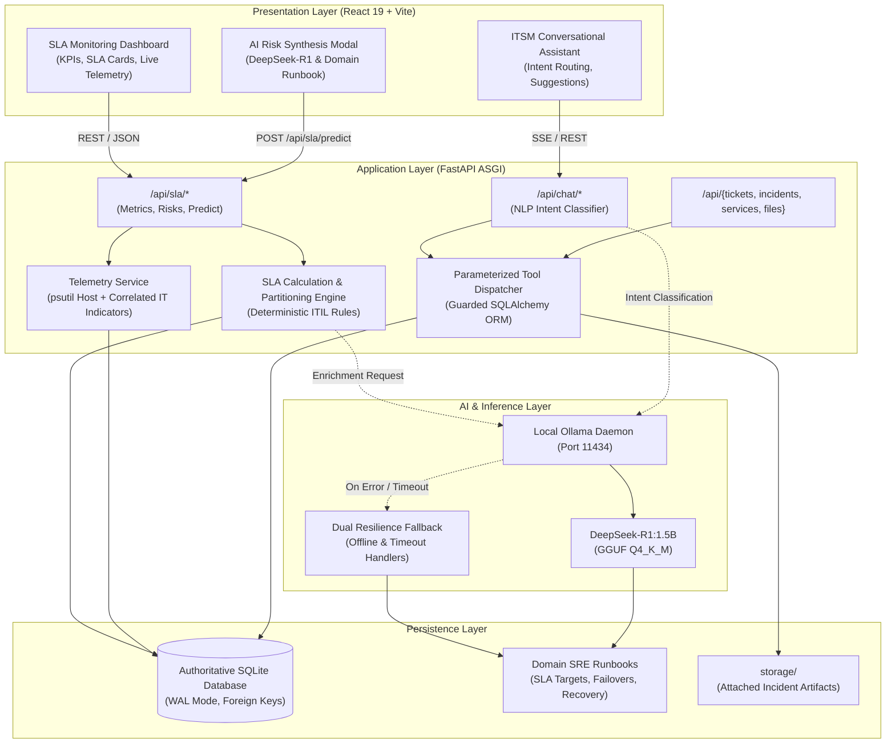

# Intelligent Service Level Management (ISLM) Using a Small Language Model

[](https://www.python.org/)
[](https://fastapi.tiangolo.com/)
[](https://react.dev/)
[](https://www.sqlite.org/)
[](https://ollama.com/)
[](https://ollama.com/library/deepseek-r1:1.5b)
[](https://opensource.org/licenses/MIT)

> **Intelligent Service Level Management (ISLM)** is an enterprise IT Service Management (ITSM) and Service Level Agreement (SLA) operations platform powered by an on-premises, privacy-preserving **Small Language Model (DeepSeek-R1 1.5B)**. It unifies deterministic rule-based SLA tracking, host and simulated IT telemetry, ITIL-grounded domain runbooks, and natural-language assistance into a single unified system.

---

## 1. Project Overview

Modern IT organizations struggle with ticket prioritization, SLA breach prevention, and rapid incident response. Commercial LLMs introduce data-privacy risks, high operational costs, and unpredictability (hallucinations). 

**ISLM** solves this by pairing a lightweight, locally deployed Small Language Model (SLM) with a deterministic, authoritative relational backend. Numerical calculations (elapsed time, remaining deadlines, SLA percentages, breach classifications) are strictly calculated by Python and SQLite, while the SLM provides contextual reasoning, intent parsing, and domain runbook-grounded troubleshooting plans.

---

## 2. Problem Statement

1. **Unpredictable LLM Reasoning on Hard Numbers:** Generative language models frequently hallucinate timestamps, mathematical percentages, and operational metrics.
2. **Data Privacy & Compliance in ITSM:** Sending enterprise operational data, server hostnames, network topologies, and employee logs to third-party cloud APIs poses significant security and regulatory risks.
3. **Siloed Telemetry & SLA Tracking:** Monitoring telemetry (CPU, memory, packet loss) is often disconnected from ticketing workflows, delaying MTTR (Mean Time to Resolution).
4. **Hardware Constraints:** Small and medium enterprises require intelligent IT automation that runs on standard commodity workstations without expensive multi-GPU clusters.

---

## 3. Project Objectives

- **100% Deterministic SLA Accuracy:** Ensure all countdowns, breach statuses, percentages, and metrics displayed in dashboards and AI modals derive from a single authoritative SQLite source.
- **Privacy-Preserving On-Premises SLM:** Run DeepSeek-R1 1.5B entirely on local CPU/RAM via Ollama without cloud telemetry or data leakage.
- **Domain Runbook-Grounded Troubleshooting:** Ground AI recommendations directly in verified SRE procedures and operational runbooks rather than speculative generative answers.
- **Fail-Safe Operational Resilience:** Implement sub-3-second fallback mechanisms that guarantee uninterrupted dashboard functionality and technical action plans even if the local SLM daemon is offline or times out.
- **Dual-Interface Management:** Provide both a visual real-time SLA Monitoring Dashboard and an interactive conversational assistant with safe parameterized execution.

---

## 4. System Architecture



---

## 5. Technology Stack

| Component | Technology | Version | Purpose |
| :--- | :--- | :--- | :--- |
| **Frontend Framework** | React | 19.2.x | High-performance user interface, component state management |
| **Build Tool** | Vite | 8.2.x | Ultra-fast HMR and production bundle optimization |
| **Styling** | Vanilla CSS3 | Modern CSS | Glassmorphism aesthetics, responsive CSS Grid / Flexbox |
| **Backend Framework** | FastAPI | 0.110+ | Asynchronous REST API, OpenAPI docs, Pydantic validation |
| **ASGI Server** | Uvicorn | 0.28+ | High-throughput asynchronous server |
| **Database Engine** | SQLite 3 | WAL Mode | Zero-configuration ACID transactional persistence |
| **ORM Layer** | SQLAlchemy | 2.0+ | Parameterized SQL queries, type-safe data modeling |
| **Local SLM Engine** | Ollama | Latest | Local model hosting, OpenAI-compatible REST API |
| **Model** | DeepSeek-R1:1.5B | Q4_K_M GGUF | Qualitative reasoning, incident analysis, intent parsing |
| **Host Telemetry** | psutil | 5.9+ | Real-time host CPU, virtual memory, and process statistics |

---

## 6. Main Modules and Features

### 6.1 Real-Time SLA Monitoring Dashboard
- **Mutually Exclusive SLA Partitioning:** Guaranteed zero-overlap categorization:
  $$\text{Total Monitored} = \text{Breached} + \text{At Risk} + \text{Healthy}$$
  $$\text{Compliance Rate} = \frac{\text{Total Monitored} - \text{Breached}}{\text{Total Monitored}} \times 100$$
- **Synchronized Evaluation Clocks:** Dashboard cards and AI modals share the exact evaluation reference timestamp to eliminate clock drift.
- **Incident & Ticket Monitoring:** Tracks both reactive end-user support tickets and infrastructure incidents.

### 6.2 Host & IT Infrastructure Telemetry
- **Real Host Telemetry (Live):** Localhost TCP socket latency, SQLite query response latency (`SELECT 1`), host CPU utilization percentage, and virtual memory consumption.
- **Correlated Simulated IT Telemetry:** Clearly labeled simulated indicators (WAN latency, packet loss, Cisco router status, Redis cache disk capacity, replication lag) dynamically correlated with active incidents.

### 6.3 Domain Runbook-Grounded SLM
- **Factual Grounding:** Numerical SLA calculations are injected from SQLite into the SLM prompt, preventing numerical hallucinations.
- **Structured 6-Part AI Synthesis:**
  1. Authoritative SLA Factsheet (SQLite-derived)
  2. Observed Telemetry Context
  3. SLM Hypothesis (clearly demarcated as unverified)
  4. Specific Troubleshooting Steps (grounded in the verified runbook)
  5. Preventive Recommendations
  6. Confidence Score & Human Verification Notice
- **Resolved Incident Protocol:** When inspecting resolved incidents, the SLM automatically pivots to historical compliance reviews and post-mortem recommendations.

### 6.4 Conversational ITSM Assistant
- **Safe Parameterized Dispatch:** Translates natural-language operational requests into safe ORM operations.
- **Two-Phase Confirmation Protocol:** Destructive operations (`DELETE`, record termination) require explicit user confirmation before execution.

---

## 7. How the Small Language Model Works

```
User Action / Incident Inspection
               │
               ▼
   authoritative SQLite Evaluation
   (Elapsed time, remaining time, SLA %)
               │
               ▼
   Telemetry Context Assembly
   (Validated host & network metrics)
               │
               ▼
   Domain Runbook Retrieval
   (Matching incident category to runbook)
               │
               ▼
   Strict System Prompt Construction
   (Instructions + Factual Invariants)
               │
               ▼
   Local Inference via Ollama (DeepSeek-R1:1.5B)
   ┌───────────────────────┬───────────────────────┐
   │ Success (< 120s)      │ Daemon Offline / Timeout
   ▼                       ▼
Structured Synthesis    Dual Fallback Engine
(6 Standard Sections)   (Deterministic Runbook Injected)
               │                       │
               └───────────┬───────────┘
                           ▼
             Rendered in UI Modal
```

---

## 8. DeepSeek-R1 1.5B and Ollama

### Why DeepSeek-R1 1.5B?
DeepSeek-R1:1.5B is a compact, reasoning-optimized Small Language Model based on the Qwen2 architecture. With 1.8 billion parameters quantized to 4-bit (`Q4_K_M`), it requires only **~1.1 GB of RAM/VRAM**, allowing it to execute entirely on standard multi-core desktop CPUs without dedicated graphics hardware.

### Benchmark & Evaluation Highlights
Based on our experimental evaluation across 12 live operational test cases:
- **Mean Inference Latency:** 55.5 seconds on commodity 4-core/8-thread CPUs.
- **SLA Factual Parity:** 100.0% agreement between model text and SQLite facts.
- **Completeness:** 100.0% generation of all required technical sections.
- **Fallback Speed:** Immediate 2.1s recovery when Ollama is offline; 1.8s recovery on timeout.

---

## 9. Database Description

The system persists data in SQLite with Write-Ahead Logging (`WAL`) mode and foreign key enforcement enabled:

| Table | Primary Columns | Purpose |
| :--- | :--- | :--- |
| `users` | `id`, `name`, `email`, `role`, `created_at` | ITSM staff, technicians, and system administrators |
| `services` | `id`, `service_name`, `description`, `status`, `owner` | Core infrastructure services (Database, Network, API Gateway, etc.) |
| `tickets` | `id`, `title`, `description`, `category`, `priority`, `status`, `assigned_to`, `service_id` | End-user service and support requests |
| `incidents` | `id`, `incident_id`, `title`, `severity`, `status`, `affected_service`, `affected_component` | Production outages, infrastructure alerts, monitoring triggers |
| `sla` | `id`, `service_id`, `priority`, `response_time`, `resolution_time` | Service level commitments and resolution targets |
| `files` | `id`, `file_name`, `file_path`, `file_size`, `uploaded_by` | Operational runbooks, diagnostic logs, and post-mortems |

---

## 10. Installation Prerequisites

Ensure the following tools are installed on your Windows computer:

1. **Python 3.10 or newer:** [Download Python](https://www.python.org/downloads/) (Ensure `Add Python to PATH` is checked during installation).
2. **Node.js 18 or newer:** [Download Node.js](https://nodejs.org/) (Includes `npm`).
3. **Ollama:** [Download Ollama for Windows](https://ollama.com/download).

---

## 11. Environment Variable Configuration

Create your local `.env` configuration file from the template:

```bash
# In the project root directory
copy .env.example .env
```

Your `.env` file contains:

```ini
# Database Connection (uses SQLite relative path)
DATABASE_URL=sqlite:///./islm_recovered.db

# Ollama / SLM Configuration
OLLAMA_URL=http://localhost:11434
OLLAMA_MODEL=deepseek-r1:1.5b

# File Storage Configuration
STORAGE_PATH=./storage
MAX_FILE_SIZE_MB=10
ALLOWED_FILE_TYPES=.pdf,.doc,.docx,.txt,.csv,.xlsx,.png,.jpg,.jpeg,.log,.json,.xml
```

---

## 12. Ollama Model Download & Execution

1. Start the Ollama application from the Windows Start menu or terminal:
   ```bash
   ollama serve
   ```
2. In a separate terminal, pull the required model:
   ```bash
   ollama pull deepseek-r1:1.5b
   ```
3. Verify the model is downloaded and accessible:
   ```bash
   ollama list
   ```

---

## 13. Backend Setup & Execution

1. Open a PowerShell terminal in the project root:
   ```powershell
   # Install backend Python dependencies
   pip install -r backend/requirements.txt
   ```
2. Initialize and seed the SQLite database with baseline ITSM records:
   ```powershell
   python -m backend.database.seed
   ```
3. Start the FastAPI backend server:
   ```powershell
   python -m uvicorn backend.main:app --host 127.0.0.1 --port 8000 --reload
   ```
   - Interactive Swagger API Documentation: [http://127.0.0.1:8000/docs](http://127.0.0.1:8000/docs)
   - Backend Health Check: [http://127.0.0.1:8000/api/health](http://127.0.0.1:8000/api/health)

---

## 14. Frontend Setup & Execution

1. Open a separate PowerShell terminal in the `frontend` directory:
   ```powershell
   cd frontend
   npm install
   ```
2. Start the Vite development server:
   ```powershell
   npm run dev
   ```
3. Open your browser and navigate to **[http://localhost:5173](http://localhost:5173)**.

> **Tip:** You can also run the all-in-one startup script `start.bat` from the project root to automatically check dependencies, seed the database, and launch both backend and frontend servers.

---

## 15. Testing Instructions

### 15.1 Backend Test Suite
Run the automated pytest suite covering database connectivity, health checks, SLA calculation engines, duration parsing, and telemetry:

```powershell
# From project root
python -m pytest
```

Expected output:
```
tests\test_backend.py ......                                             [100%]
============================== 6 passed in 5.73s ==============================
```

### 15.2 Frontend Build & Lint Verification
Verify that the React application compiles cleanly and passes all code quality checks:

```powershell
cd frontend

# Run Oxlint
npm run lint

# Run production build
npm run build
```

---

## 16. Screenshots & Interface Overview

| View | Description | Key Elements |
| :--- | :--- | :--- |
| **SLA Monitoring Dashboard** | Real-time operations center for SLA adherence | KPI metric cards (Total Monitored, Breached, At Risk, Healthy), Compliance Progress Bar, Entity filters |
| **DeepSeek-R1 AI Risk Modal** | Qualitative incident root cause & action synthesis | Authoritative SQLite factsheet, observed telemetry interpretation, grounded runbook steps |
| **ITSM Chat Assistant** | Conversational service management interface | Natural-language querying, suggestion chips, parameterized tables, two-phase confirmation |
| **Live Telemetry Center** | Host infrastructure & correlated IT indicators | SQLite response time (`SELECT 1`), host CPU & RAM (`psutil`), simulated WAN loss & router metrics |

*(Visual screenshots can be captured directly from the live application at `http://localhost:5173`)*

---

## 17. Limitations & Future Enhancements

### Current Limitations
- **CPU Inference Latency:** Running DeepSeek-R1 1.5B on standard desktop CPUs without GPU acceleration results in an average response time of ~55 seconds for deep qualitative synthesis.
- **Simulated IT Telemetry:** WAN latency, router utilization, and packet loss are synthesized and correlated based on database records rather than live SNMP/NETCONF polling.
- **SQLite Concurrency:** While SQLite in WAL mode provides high read concurrency, high-throughput enterprise deployments with hundreds of concurrent writes would benefit from PostgreSQL.

### Future Enhancements
- **GPU Acceleration Integration:** Enable direct CUDA / ROCm acceleration in Ollama to reduce SLM inference latency to under 3 seconds.
- **Enterprise Vector Retrieval (RAG):** Integrate a local vector store (e.g., ChromaDB / FAISS) for indexing thousands of enterprise PDF/DOCX manuals.
- **SNMP / OpenTelemetry Ingestion:** Connect live Cisco IOS-XE and Prometheus metric scrapers to replace simulated indicators with real hardware feeds.
- **Multi-Tenant RBAC:** Add role-based authentication (OAuth2 / OpenID Connect) to support distinct customer organizations.

---

## License

This project is released under the MIT License.
